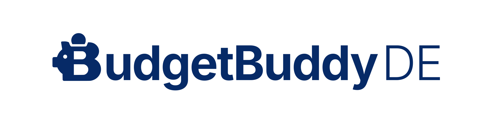

<p align="center">
  <picture>
    <source media="(prefers-color-scheme: dark)" srcset="assets/wordmark-logo/budgetbuddyde-wordmark-light.svg" />
    <source media="(prefers-color-scheme: light)" srcset="assets/wordmark-logo/budgetbuddyde-wordmark-dark.svg" />
    
  </picture>

  <p align="center">
    
    
    
    
  </p>

  <p align="center">
    <a href="https://budget-buddy.de">Website</a>
    ·
    <a href="https://app.budget-buddy.de">App</a>
    ·
    <a href="https://docs.budget-buddy.de">Docs</a>
    ·
    <a href="https://github.com/BudgetBuddyDE/BudgetBuddyDE/issues">Issues</a>
  </p>
</p>

# BudgetBuddyDE

An open-source personal finance manager for tracking transactions, recurring payments, budgets and insights. The application consists of a Next.js web app, an authenticated Express API and shared TypeScript packages. Track income and expenses, organize categories and payment methods, manage subscriptions, and explore your financial history with interactive analytics.

## Getting started

For hosted use, visit the [BudgetBuddyDE app](https://app.budget-buddy.de). To run the full stack locally, use Node.js 24.21.0, npm 11.4.2 and Docker Compose.

```bash
git clone https://github.com/BudgetBuddyDE/BudgetBuddyDE.git
cd BudgetBuddyDE
docker compose up -d
```

Copy the workspace environment templates, then set the required secrets and service URLs:

```powershell
Copy-Item apps/webapp/.env.example apps/webapp/.env.local
Copy-Item services/backend/.env.example services/backend/.env
```

The backend needs a secure `AUTH_SECRET` and a valid `RESEND_API_KEY`. The web app needs `NEXT_PUBLIC_BACKEND_SERVICE_HOST=http://localhost:9000`. See the [environment variable reference](https://docs.budget-buddy.de/self-hosting/configuration) for all required and optional values.

Install the workspace dependencies and build internal packages:

```bash
npm install
npm run build-packages
```

See the [installation guide](https://docs.budget-buddy.de/self-hosting/installation) for complete setup instructions.

## Development

Start all Turbo-managed development services:

```bash
npm run dev
```

Or run only the backend services:

```bash
npm run dev-services
```

Vite+ 1.3.0 provides the repository's formatting, linting and test tools. Use the installed project CLI through npm:

```bash
npm exec -- vp check
npm exec -- vp test
npm run typecheck
```

Use `vp run <task>` to invoke a project script: `vp dev` is Vite's built-in dev server, while `vp run dev` runs this repository's Turbo/Next.js development script. Likewise, `vp run build` invokes the workspace build scripts; use `npm run build` to build the complete monorepo in dependency order.

Useful checks include:

```bash
npm run lint:check
npm run typecheck
npm test
npm run build
npm run ci
```

Run a single workspace with npm, for example `npm test --workspace @budgetbuddyde/api`. Webapp tests use happy-dom and four workers on Windows. Backend tests collect V8 coverage and enforce 80% minimum statements, branches, functions and lines.

The repository is an npm-workspace monorepo orchestrated by Turborepo:

- `apps/webapp` : Next.js personal-finance application.
- `apps/documentation` : Fumapress documentation site.
- `apps/website` : static landing page.
- `services/backend` : Express, Better Auth, REST API and MCP endpoint.
- `packages/api`, `packages/db`, `packages/core`, `packages/logger`, `packages/charts` : shared API, data, runtime, logging and chart packages.
- `examples/api-key-client` : runnable API-key integration example.

## Deployment

<p align="center">
  <strong>One-click deploy on Railway:</strong><br/>
  <a href="https://railway.com/deploy/WjE5vD?referralCode=SD-6Xm&utm_medium=integration&utm_source=template&utm_campaign=generic">
    
  </a>
</p>

For self-hosting, configure the backend, PostgreSQL, Redis and object storage using the [production guide](https://docs.budget-buddy.de/self-hosting/production). The [updating guide](https://docs.budget-buddy.de/self-hosting/updating) covers database migrations, backups and deployment upgrades. The one-click Railway template may not include every optional integration, such as attachment object storage.

## Resources

- [Website](https://budget-buddy.de) · [Hosted app](https://app.budget-buddy.de) · [Documentation](https://docs.budget-buddy.de)
- [Development setup](https://docs.budget-buddy.de/developers/getting-started) · [Architecture](https://docs.budget-buddy.de/developers/architecture)
- [API and MCP](https://docs.budget-buddy.de/developers/api-and-mcp) · [Self-hosting](https://docs.budget-buddy.de/self-hosting/overview)
- [Issues and feature requests](https://github.com/BudgetBuddyDE/BudgetBuddyDE/issues) · [Contributing](https://github.com/BudgetBuddyDE/BudgetBuddyDE/blob/main/CONTRIBUTING.md)

## Credits

Built with open-source projects:

- [Vite+](https://viteplus.dev/) and [Vite](https://vite.dev/) : unified development toolchain and build tooling.
- [Turborepo](https://turbo.build/repo) : monorepo task orchestration.
- [Concourse CI](https://concourse-ci.org/) : continuous integration pipelines.
- [Next.js](https://nextjs.org/) : web application framework.
- [Material UI](https://mui.com/) : React UI components and data grid.
- [Express.js](https://expressjs.com/) : backend HTTP framework.
