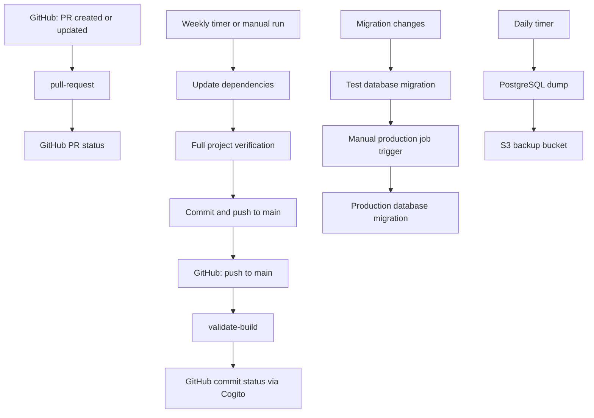

The documented Concourse instance is `https://ci.tklein.it`, with pipelines in the `budgetbuddyde` team. Current definitions live in `ci/`. Reusable tasks load from `ci-source` on `main`. The project pipeline validates all npm workspaces; the database pipeline handles migrations and backups separately.

## HashiCorp Vault credential manager

The deployment uses Vault to resolve credentials. With the documented lookup configuration, Concourse searches `/concourse/budgetbuddyde/<pipeline>/<name>` before `/concourse/budgetbuddyde/<name>`.

A dotted reference selects a field: `((github.private_key))` reads `private_key` from the `github` secret. Plain configuration is supplied with `ci/vars.yml` or `fly -v`; unresolved credential references are resolved through the credential manager. Never put secrets in committed variable files or command-line variables. Task scripts must also avoid printing secrets: credential management does not make arbitrary build output safe.

### Secret inventory

| Reference                                                             | Used by                                                                            |
| --------------------------------------------------------------------- | ---------------------------------------------------------------------------------- |
| `github.private_key`                                                  | Git checkouts; the project pipeline also needs write access for dependency updates |
| `github.pat`                                                          | Cogito commit statuses and GitHub PR discovery/statuses                            |
| `s3-db-backup.bucket`, `region`, `access_key_id`, `access_key_secret` | Database backup uploads                                                            |
| `database.test-database-url`                                          | Test migrations                                                                    |
| `database.prod-database-url`                                          | Production migrations                                                              |

The project pipeline does not use `s3-versions`, `npm_token`, Docker registry credentials, or Discord notifications. Existing credentials/data for historical release pipelines are not deleted by changing the repository.

## Resources

| Resource type    | Purpose                                                                             |
| ---------------- | ----------------------------------------------------------------------------------- |
| `git`            | Main checkouts, dependency-update pushes, and migration-filtered database checkouts |
| `registry-image` | Node 24.21.0 task images and PostgreSQL 17 backup image                             |
| `github-pr`      | PR discovery and statuses through `cfcommunity/github-pr-resource:0.26.0`           |
| `cogito`         | GitHub commit statuses through `pix4d/cogito`                                       |
| `time`           | Weekly dependency updates and daily database backups                                |
| `s3`             | PostgreSQL backup storage                                                           |

In the project pipeline, `repository` tracks main commits and triggers validation. `repository-write` points to the same remote but is used by dependency updates. Separate write resources keep Git puts from directly introducing versions into the validation resource; the main check still detects dependency commits normally. The write checkout includes CI-skipped commits, while validation discovery honors skip markers.

## Flow

All project verification goes through the root npm scripts and Turborepo. There is no versioning, release job, artifact publication, or deployment. Live Concourse configuration and permissions require operator changes; updating YAML alone does not alter the running instance.

## Related pages

- [Pipelines](/ci/pipelines) - jobs and tasks.
- [Operating](/ci/operating) - configure pipelines with `fly`.
